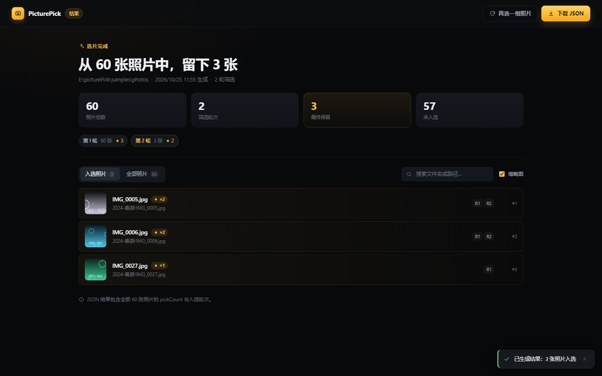

# PicturePick · 本地照片逐轮选片器

一个 **前后端分离** 的本地选片工具：后端 Python（FastAPI）+ 前端 TypeScript/HTML（Vite），
既可以用「命令行启动 + 浏览器操作」，也可以直接运行打包好的 **Windows 桌面程序**。

核心玩法：选定一个照片目录 → 逐张浏览、放大/缩小、可自动放映 → 点「保留（pick）」标记心仪照片 →
结束本轮后 **只在已保留的照片里继续下一轮** → 循环几轮直到选出最终结果 →
导出 JSON，记录每张照片被 pick 的总次数与入选轮次。


## 功能一览

| # | 需求 | 实现 |
| --- | --- | --- |
| 1 | 选择目录 | 手输路径 / 目录浏览弹窗（盘符·上级·面包屑）/ 系统原生目录框；桌面端走原生对话框 |
| 2 | 扫描 jpg | 递归扫描 `.jpg` / `.jpeg`（大小写不敏感），自动排序，跳过非图片文件 |
| 3 | 选片 + 自动放映 | 上一张 / 下一张按钮；自动放映可设置间隔秒数、播放/暂停；到末尾自动停止 |
| 4 | 常规显示操作 | 滚轮以光标为中心缩放、拖拽平移、± 缩放、适应窗口、1:1、双击切换、旋转、全屏 |
| 5 | pick 与统计 | 「保留」按钮可点选/取消；顶栏实时显示 当前序号 / 已浏览 / 本轮保留 / 总数 |
| 6 | 多轮筛选 | 「结束本轮」弹窗显示保留数量并询问是否进入下一轮（仅从保留照片中继续）；可随时结束 |
| 7 | 生成 JSON | 结果页可下载/另存 JSON：每张照片的 `pickCount` 与 `pickedInRounds`（被 pick 的轮次） |

界面细节：深色 Lightroom 风格、大图 + 底部胶片条（懒加载缩略图）、键盘快捷键、
图片加载失败重试、未结束会话离开提示、错误 toast。

## 三种运行方式

### 方式一：桌面版（免安装，开箱即用）

打包产物位于 `release/`：

| 文件 | 说明 |
| --- | --- |
| `release/win-unpacked/PicturePick.exe` | 绿色版目录（双击即用） |
| `release/PicturePick-1.0.0-win-x64-portable.exe` | 单文件便携版 |
| `release/PicturePick-1.0.0-win-x64-setup.exe` | NSIS 安装包（可选安装目录） |

桌面端会自动在后台拉起内置的 Python 后端（随机空闲端口），打开后按界面提示选择目录即可。
`resources/backend` 中是 PyInstaller 打包的后端 sidecar，退出应用时会自动结束后端进程。

> 如需从零自行打包：见下文「从源码构建」。

### 方式二：命令行 + 浏览器

```powershell
cd E:\picturePick\backend
python -m picturepick serve --dir "D:\我的照片"     # 启动后自动打开浏览器
```

- 不加 `--dir` 也可以：启动后在网页里选择目录。
- 默认端口 `8000`，可用 `--port 8100` 指定；`--no-open` 不自动打开浏览器。
- 其他命令：

```powershell
python -m picturepick version
python -m picturepick scan --dir "D:\我的照片"              # 预览会扫到多少张（默认递归）
python -m picturepick scan --dir "D:\我的照片" --no-recursive
```

依赖：Python 3.10+，`pip install -r backend/requirements.txt`
（FastAPI / uvicorn / Pillow / pydantic）。

### 方式三：开发模式（前后端分离调试）

```powershell
# 一条命令同时起后端(8000) + Vite 前端(5173)
powershell -ExecutionPolicy Bypass -File scripts\dev.ps1
# 浏览器打开 http://127.0.0.1:5173
```

前端构建产物固定输出到 `backend/picturepick/webui`，因此也可以只跑后端：

```powershell
cd frontend; npm install; npm run build      # → backend/picturepick/webui
cd ..\backend; python -m picturepick serve    # → http://127.0.0.1:8000/
```

## 使用流程

1. **选择目录**：输入/粘贴照片目录，或用「浏览目录」逐级选择（桌面端可直接调系统目录框）。
2. **逐张筛选**：`←/→` 或按钮切换；滚轮缩放、拖拽平移；空格自动放映；`P` 或「保留」按钮标记。
3. **结束本轮**：点击「结束本轮」，弹窗会显示本轮保留数量：
   - 「进入下一轮」：仅在保留的照片中继续筛选（**至少保留 2 张**才可进入下一轮）；
   - 「结束并生成结果」：随时可结束，生成最终 JSON。
4. **重复第 2–3 步**，每轮范围都会缩小。
5. **结果页**：查看摘要与按 `pickCount` 排序的列表，点击「下载 JSON」保存到本机。




### 快捷键

| 按键 | 作用 | 按键 | 作用 |
| --- | --- | --- | --- |
| `←` / `→` | 上一张 / 下一张 | `P` | 保留 / 取消保留 |
| `空格` | 自动放映 播放/暂停 | `+` / `-` | 放大 / 缩小 |
| `0` | 适应窗口 | `1` | 原始大小 1:1 |
| `R` | 旋转 | `F` | 全屏 |
| `Esc` | 关闭弹窗 / 退出全屏 | | |

## 结果 JSON 格式

```json
{
  "schemaVersion": 1,
  "generatedAt": "2026-10-25T10:44:10+08:00",
  "sourceDirectory": "E:\\photos",
  "recursive": true,
  "totalPhotos": 60,
  "roundsPlayed": 2,
  "pickedPhotoCount": 3,
  "photos": [
    {
      "id": "011b8657457565a2",
      "name": "IMG_0005.jpg",
      "relativePath": "2024-春游/IMG_0005.jpg",
      "absolutePath": "E:\\photos\\2024-春游\\IMG_0005.jpg",
      "pickCount": 2,
      "pickedInRounds": [1, 2]
    }
  ]
}
```

- `photos` 包含**全部**扫到的照片（未入选的 `pickCount` 为 0），按 `pickCount` 降序、路径升序排序。
- `pickCount` = 该照片在历史各轮中被 pick 的总次数；`pickedInRounds` = 具体轮次。
- 文件为标准 UTF-8 JSON，可直接用于后续统计或导入其他工具。

## 技术架构

```
浏览器 / Electron 窗口
        │  HTTP（仅本机 127.0.0.1）
        ▼
FastAPI 后端（Python）  ── 扫描目录 / 会话与轮次状态 / pick 计数 / 缩略图(Pillow) / JSON 生成
        │
        └── 静态托管前端构建产物（Vite 打包的 HTML/JS/CSS）

Electron 主进程：选空闲端口 → 启动 Python sidecar → 轮询 /api/health → 加载页面；退出时杀进程树
```

```
E:\picturePick\
├── backend/                  # Python 后端（FastAPI + uvicorn + Pillow）
│   ├── picturepick/          # app / api / models / scanner / session / export / imaging / fsbrowse / cli
│   ├── tests/                # pytest（82 个用例）
│   └── pyproject.toml / requirements.txt
├── frontend/                 # TypeScript + Vite 前端（原生 DOM，无框架）
│   └── src/                  # main / api / viewer / ui/*（启动页·选片·胶片条·结果页·弹窗·toast）
├── desktop/                  # Electron 外壳 + PyInstaller spec + electron-builder 配置
│   ├── src/main.ts           # 窗口/端口/后端 sidecar/健康检查/IPC/退出清理
│   ├── src/preload.ts        # window.picturePickDesktop（原生目录选择、另存 JSON）
│   └── pyinstaller/          # 后端 sidecar 打包配置
├── docs/                     # API 契约（API.md）、架构约定、验证记录、截图
├── scripts/                  # dev.ps1（开发模式）、build.ps1（一键构建）、e2e_api.py、样例照片生成器
├── build/backend/            # PyInstaller 后端产物（分发给桌面端）
└── release/                  # 桌面端安装包 / 绿色版
```

接口契约（前后端唯一准绳）见 [`docs/API.md`](docs/API.md)，工程约定见 [`docs/ARCHITECTURE.md`](docs/ARCHITECTURE.md)。

## 从源码构建

前置：Python 3.10+（含 pip）、Node.js 18+（npm）。

```powershell
# 一键：前端构建 → PyInstaller 后端 → Electron 绿色版
powershell -ExecutionPolicy Bypass -File scripts\build.ps1

# 需要 NSIS 安装包时（联网下载 electron-builder 工具链）
powershell -ExecutionPolicy Bypass -File scripts\build.ps1 -WithInstaller
```

分步命令：

```powershell
cd frontend; npm install; npm run build          # → backend/picturepick/webui
cd ..\desktop; npm install; npm run build        # tsc → dist/main.js、dist/preload.js
npm run pack:backend                             # → build/backend/picturepick-backend.exe
npm run dist                                     # electron-builder → release/（portable + nsis）
npm start                                        # 开发模式直接启动 Electron 窗口
```

> 本仓库的开发沙箱（受限 Windows 文件/进程沙箱）还额外准备了 `desktop/scripts/eb-sandbox.cjs`
> 与 Vite 的 `esbuild-wasm` 兼容启动器；普通桌面环境无需关心，直接使用上面的标准命令即可。
> 细节见 `desktop/README.md` 与 `frontend/README.md`。

## 测试与验证

| 项目 | 命令 | 结果 |
| --- | --- | --- |
| 后端单元/接口 | `cd backend; python -m pytest -q` | 82 passed |
| API 端到端（源码实例 + 打包实例） | `python scripts/e2e_api.py --base-url ... --photos-dir samples\photos` | PASS=60 / FAIL=0 ×2 |
| 浏览器全流程 UI（Playwright/Chromium） | 选目录→pick→多轮→下载 JSON 校验 | PASS=42 / FAIL=0 |
| 打包产物 | 后端 exe、app.asar、安装包结构校验 | 全部通过 |

完整证据与命令见 [`docs/VERIFICATION.md`](docs/VERIFICATION.md)。
桌面窗口的最终人工确认（AI 沙箱内的 Chromium 无法创建命名管道，属环境限制）：

```powershell
powershell -ExecutionPolicy Bypass -File desktop\scripts\verify-shell.ps1 -Mode app
# 或直接双击 release\win-unpacked\PicturePick.exe
```

## 第三方开源库

均选用社区活跃、成熟广泛使用的项目：

- 后端：FastAPI、uvicorn、Pillow、pydantic、httpx（测试）、pytest
- 前端：TypeScript、Vite
- 桌面端：Electron、electron-builder、PyInstaller
- 验证：Playwright（Chromium）

## 常见问题

- **端口被占用**：`serve` 会打印 `Error: port ... is already in use` 并退出，换 `--port` 即可；桌面端自动选择空闲端口。
- **目录选不了 / 系统目录框没弹出**：浏览器模式会回退到内置目录浏览器；桌面端使用系统原生对话框。
- **下一轮按钮是灰的**：进入下一轮至少需要在当前轮保留 2 张照片。
- **JSON 保存在哪里**：浏览器为默认下载目录；桌面端点击「下载 JSON」会弹出「另存为」对话框。
- **照片不会上传**：所有数据都在本机处理，后端只监听 `127.0.0.1`。
