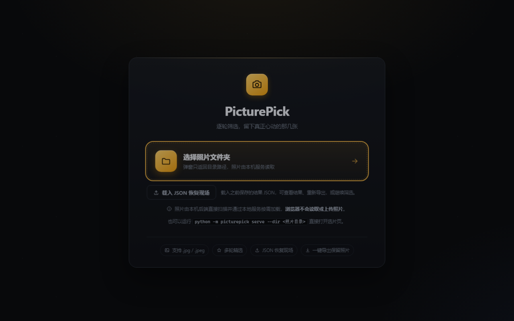
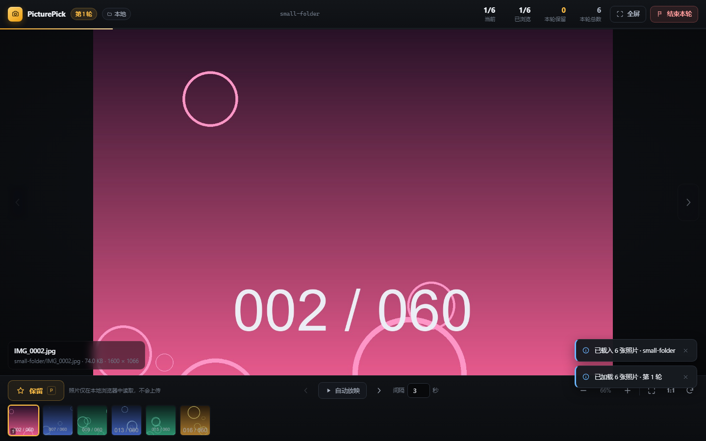
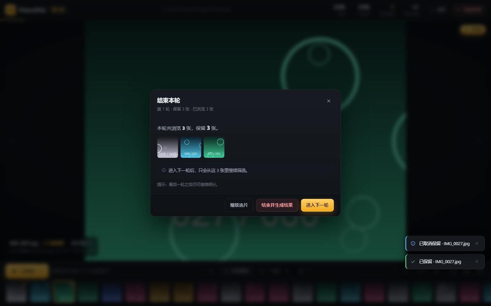
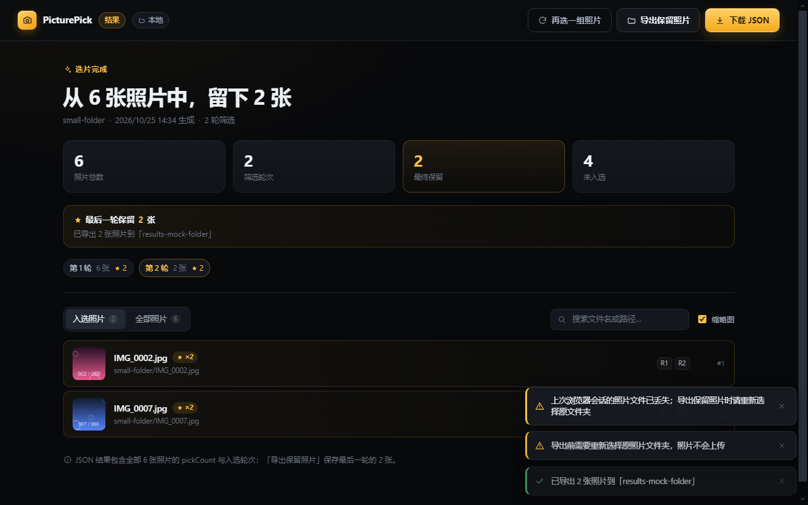
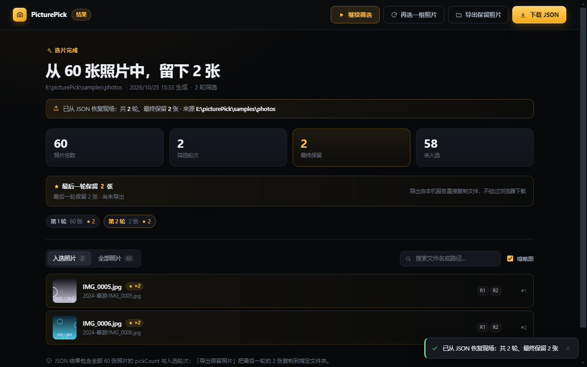
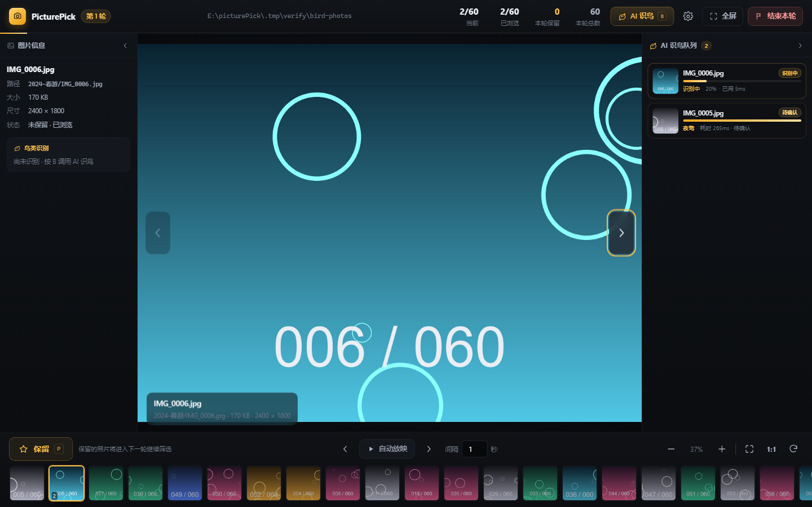
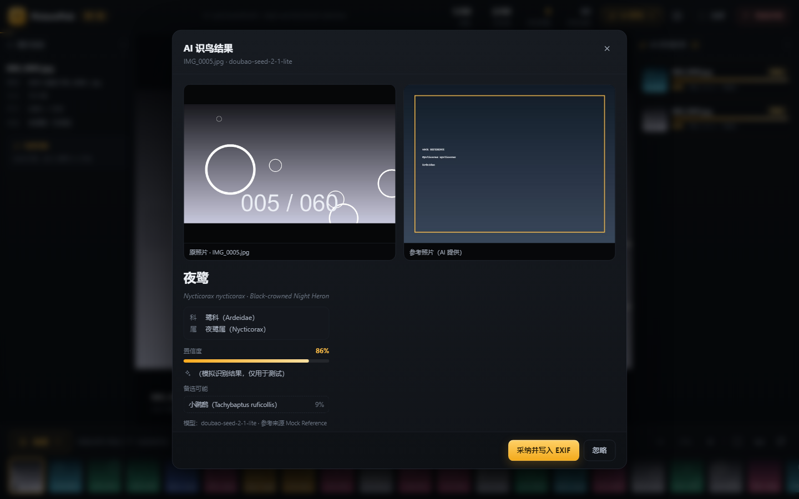
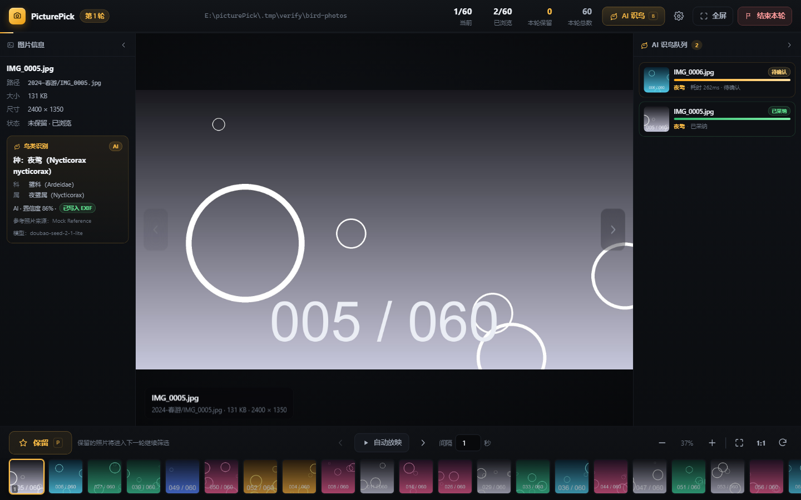
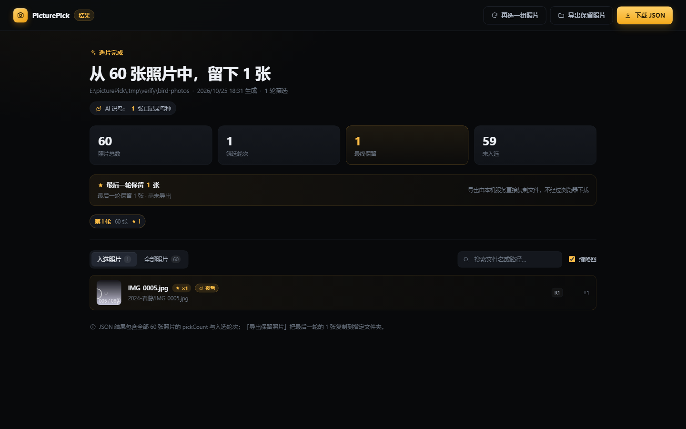

# PicturePick · 本地照片逐轮选片器

一个 **前后端分离** 的本地选片工具：后端 Python（FastAPI）+ 前端 TypeScript/HTML（Vite），
既可以用「命令行启动 + 浏览器操作」，也可以直接运行打包好的 **Windows 桌面程序**。

核心玩法：用**系统原生的文件夹选择框**选一个照片目录（**只取目录路径**，照片始终由本机 Python 后端读取，
浏览器不读取/不上传任何照片）→ 逐张浏览、放大/缩小、可自动放映 →
点「保留（pick）」标记心仪照片 → 结束本轮后 **只在已保留的照片里继续下一轮** → 循环几轮直到选出最终结果 →
下载 JSON（记录每张照片被 pick 的总次数）并**一键把最后一轮保留的照片由后端复制到你指定的文件夹**。

第 5 版新增 **AI 识鸟**（可选）：在选片页按 `B` 或点「AI 识鸟」，由本机后端调用火山方舟
`doubao-seed-2-1-lite` 多模态模型识别照片中的**科 / 属 / 种**（中文名 + 拉丁学名），并由模型 API
**联网检索**同类鸟的**参考照片**（真实图片直链，需开通方舟「联网搜索」插件；未开通时仍可识鸟但无参考图）；
识别在后台队列中进行（不影响继续选片），确认采纳后把鸟种写入**结果 JSON**与**照片 EXIF**，
之后再次浏览该照片时左侧信息栏会直接显示鸟种。



## 功能一览

| # | 需求 | 实现 |
| --- | --- | --- |
| 1 | 选择目录 | **系统原生文件夹对话框只返回绝对路径**（桌面端由宿主弹出；浏览器模式由本机后端 `/api/dialog/pick-directory` 弹出）；后端扫描目录，**浏览器不读取/不上传照片** |
| 2 | 扫描 jpg | 后端递归扫描 `.jpg` / `.jpeg`（大小写不敏感），自动排序，跳过非图片文件 |
| 3 | 选片 + 自动放映 | 上一张 / 下一张按钮；自动放映可设置间隔秒数、播放/暂停；到末尾自动停止 |
| 4 | 常规显示操作 | 滚轮以光标为中心缩放、拖拽平移、± 缩放、适应窗口、1:1、双击切换、旋转、全屏 |
| 5 | pick 与统计 | 「保留」按钮可点选/取消；顶栏实时显示 当前序号 / 已浏览 / 本轮保留 / 总数 |
| 6 | 多轮筛选 | 「结束本轮」弹窗显示保留数量并询问是否进入下一轮（仅从保留照片中继续）；可随时结束 |
| 7 | 生成 JSON | 结果页下载/另存 JSON：每张照片的 `pickCount` 与 `pickedInRounds`（被 pick 的轮次） |
| 8 | 一键导出照片 | 结果页「导出保留照片」：选择目标文件夹后，**由后端把最后一轮保留的照片复制过去**（同名自动 `-1`/`-2`，不覆盖原文件） |
| 9 | 载入 JSON 恢复现场 | 启动页「载入 JSON 恢复现场」：选择之前保存的结果 JSON，重新扫描源目录重建轮次与 pick 计数，回到结果页；可再次导出，或「继续筛选」在原保留照片上再来一轮 |
| 10 | **AI 识鸟（v5 新增）** | 选片页按钮 / 快捷键 `B` 调用火山方舟 `doubao-seed-2-1-lite` 识别**科 / 属 / 种**（中文 + 拉丁）；参考照片由**模型 API 联网检索**（需开通方舟「联网搜索」插件）；后台单线程队列在**右侧边栏**显示进度，可继续选片/继续提交；点击任务卡片查看「原照片 + 参考照片」对照与结果，采纳后写入**结果 JSON**与**照片 EXIF**，再次浏览时**左侧信息栏**显示鸟种；支持模拟模式（`PICTUREPICK_BIRD_MOCK=1`）与恢复现场后保留鸟种 |

界面：深色 Lightroom 风格、大图 + 底部胶片条（本地生成缩略图）、键盘快捷键、加载失败重试、
未结束会话离开提示、错误 toast。v5 选片页为**三栏布局**（左：图片信息含鸟种；中：大图舞台；
右：AI 识鸟任务队列，可折叠），窗口较窄时左右栏默认收起。所有照片数据只在本机浏览器/进程内处理，
后端只监听 `127.0.0.1`；只有用户主动使用 AI 识鸟时，当前照片才会被上传到火山方舟（见下文隐私说明）。






**v5 AI 识鸟界面**（模拟模式，UI e2e 生成；模拟模式的参考图为本地生成的演示示意图，
真实模式的参考图由模型 API 联网检索提供）：






> 上方 `start/picker/...` 为 v4 界面截图；v5 三栏布局与 AI 识鸟界面以 `bird-*.png` 为准。

## 三种运行方式

### 方式一：桌面版（免安装，开箱即用）

桌面版是 **PyInstaller + pywebview（Edge WebView2）** 原生窗口，内置 Python 后端与前端资源，
不需要预装 Python，也不依赖 Electron。

**打包**（在本机运行，一条命令）：

```powershell
# 在资源管理器里双击 build.cmd，或执行：
powershell -ExecutionPolicy Bypass -File scripts\build.ps1
```

产物：

| 路径 | 说明 |
| --- | --- |
| `release/PicturePick-WebView2/PicturePick.exe` | 绿色版目录（整个目录一起分发，双击即用，约 33 MB） |
| `release/PicturePick-WebView2-win-x64.zip` | 上述目录的压缩包（约 17 MB） |

> 已知问题：打包后的 WebView2 窗口需要 pythonnet 加载 .NET 运行时，当前发行包在部分机器上会报
> `Failed to resolve Python.Runtime.Loader.Initialize`（已定位为 .NET Framework/coreclr 选择问题，修复中）。
> 修复完成前请优先使用下方「方式二：命令行 + 浏览器」，功能完全一致。

**启动后自检 / 验证**：

```powershell
# 双击 verify-desktop.cmd，或执行：
powershell -ExecutionPolicy Bypass -File scripts\verify-desktop.ps1
```

脚本会先做不开窗口的运行时自检（后端/前端/pythonnet/WebView2 桥接），再启动真实窗口、
自动截图并退出，最后打印 PASS/FAIL、截图路径与日志。

> 只想验证打包运行时（不弹窗口）可执行：`release\PicturePick-WebView2\PicturePick.exe --selftest-backend`，
> 结果写入 `%LOCALAPPDATA%\PicturePick\logs\desktop.log`。

> 打包/自检输出如果失败，请把控制台输出与 `.tmp/desktop-verify/` 下的日志发给开发者。
> 需要排查启动崩溃时可用带控制台的调试版：`powershell -File scripts\build.ps1 -Console`，
> 然后运行 `build\webview-console\PicturePickConsole\PicturePick.exe --selftest` 查看完整 traceback。

### 方式二：命令行 + 浏览器（开发/日常使用）

```powershell
cd E:\picturePick\backend
python -m picturepick serve --dir "D:\我的照片"     # 启动后自动打开浏览器
```

- 不加 `--dir` 也可以：启动后在网页里点「选择照片文件夹」。
- 默认端口 `8000`，可用 `--port 8100` 指定；`--no-open` 不自动打开浏览器。
- 其他命令：

```powershell
python -m picturepick version
python -m picturepick scan --dir "D:\我的照片"              # 预览会扫到多少张（默认递归）
python -m picturepick scan --dir "D:\我的照片" --no-recursive
```

依赖：Python 3.10+，`pip install -r backend/requirements.txt`（FastAPI / uvicorn / Pillow / pydantic）。
AI 识鸟使用 Python 标准库调用火山方舟 HTTP API，**无需额外安装依赖**。

### 方式三：开发模式（前后端分离调试）

```powershell
# 一条命令同时起后端(8000) + Vite 前端(5173)
powershell -ExecutionPolicy Bypass -File scripts\dev.ps1
# 浏览器打开 http://127.0.0.1:5173
```

前端构建产物固定输出到 `backend/picturepick/webui`，因此也可以只跑后端：

```powershell
cd frontend; npm install; npm run build      # → backend/picturepick/webui
cd ..\backend; python -m picturepick serve    # → http://127.0.0.1:8000/
```

## 使用流程

1. **选择文件夹**：点击「选择照片文件夹」，在弹出的**系统原生文件夹对话框**中选择相册目录
   （只返回目录路径，照片由后端读取，浏览器不会读取或上传图片）。
2. **逐张筛选**：`←/→` 或按钮切换；滚轮缩放、拖拽平移；空格自动放映；`P` 或「保留」按钮标记。
   选中某张照片后按 `B`（或点顶部「AI 识鸟」）可让它识别鸟种——识别在**后台队列**进行，不影响继续选片。
3. **结束本轮**：点击「结束本轮」，弹窗显示本轮保留数量：
   - 「进入下一轮」：仅在保留的照片中继续筛选（**至少保留 2 张**才可进入下一轮）；
   - 「结束并生成结果」：随时可结束，生成最终 JSON。
4. **重复第 2–3 步**，每轮范围都会缩小。
5. **结果页**：
   - 查看摘要与按 `pickCount` 排序的列表；
   - 「下载 JSON」保存选片记录；
   - 「导出保留照片」选择目标文件夹，由后端把最后一轮保留的照片复制过去（自动处理同名文件）；
   - 「继续筛选」：在最后一轮保留照片上再筛一轮（保留 ≥2 张时可用）。
6. **恢复现场**：下次打开应用时，点「载入 JSON 恢复现场」选择之前保存的结果 JSON，
   会自动重新扫描原目录、恢复轮次与 pick 计数并回到结果页，可继续导出或继续筛选。

### 快捷键

| 按键 | 作用 | 按键 | 作用 |
| --- | --- | --- | --- |
| `←` / `→` | 上一张 / 下一张 | `P` | 保留 / 取消保留 |
| `空格` | 自动放映 播放/暂停 | `+` / `-` | 放大 / 缩小 |
| `0` | 适应窗口 | `1` | 原始大小 1:1 |
| `R` | 旋转 | `F` | 全屏 |
| `B` | AI 识鸟（识别当前照片） | `Esc` | 关闭弹窗 / 退出全屏 |

## AI 识鸟（v5 新增，可选）

选片页对**当前照片**按 `B`（或点顶部「AI 识鸟」按钮）→ 后端调用火山方舟
`doubao-seed-2-1-lite` 多模态模型识别鸟的**科 / 属 / 种**（中文名 + 拉丁学名）、置信度与识别依据，
并由模型 API **联网检索**给出同类鸟的**参考照片**（真实图片直链；后端不搜索/不生成图片，只下载模型
给出的 URL）。识别调用**配置的完整 API 端点**（支持 Chat Completions 与 Responses API 两种协议，
后端原样请求、不拼接路径，见下方「AI 识鸟配置」）：

1. **提交**：按 `B` 后 toast「已提交 AI 识鸟任务 · 文件名」；任务进入**右侧边栏队列**
   （`AI 识鸟队列`），显示排队位置 / 识别进度 / 耗时。提交后可以继续选片、可以继续提交下一张。
2. **查看结果**：点击队列卡片打开结果模态框——顶部并排显示**原照片**（左）与**参考照片（AI 提供）**
   （右），下方显示种 / 科 / 属（中文 + 拉丁）、置信度、识别依据、备选鸟种与模型名；
   参考图缺失时右框显示原因或开通提示；**如果 AI 只给了网页/页面链接、没有可下载的图片文件，
   右框会直接显示可点击的「打开 AI 提供的参考链接 ↗」（新标签打开）**，可自行查看确认；
   失败/进度模态框也显示原照片；右上角 X 可关闭。
3. **采纳**：点「采纳并写入 EXIF」→ 识别结果立即写入**结果 JSON**（`photos[].bird` 与
   `birdIdentifiedCount`）并尝试写入**照片 EXIF**；之后再次浏览这张照片，左侧图片信息栏的
   「鸟类识别」块会显示鸟种（无识别时提示「尚未识别 · 按 B 调用 AI 识鸟」）。
   也可以「忽略」任务；已采纳的结果可在结果页看到鸟种胶囊与「AI 识鸟：N 张已记录鸟种」统计。
4. **结果页 / 恢复现场**：结束本轮生成的结果 JSON 带鸟种字段；「载入 JSON 恢复现场」后鸟种立即生效，
   继续选片（resume）也不会丢失。

### AI 识鸟配置

真实识别需要**火山方舟 API Key**（在本机生成）：任选一种方式配置——

- **页面设置（推荐）**：启动页底部「AI 识鸟设置」按钮，或选片页顶部齿轮图标 →
  填写 API Key（高级里可改 **API 端点（完整 URL）** / 模型名）→「保存」；
  「测试连接」可用一条极小请求验证 Key / 端点 / 模型 / 网络。
- **环境变量（优先于页面设置）**：

  | 变量 | 作用 | 默认 |
  | --- | --- | --- |
  | `PICTUREPICK_ARK_API_KEY`（或 `ARK_API_KEY`） | 方舟 API Key | 无 |
  | `PICTUREPICK_ARK_ENDPOINT` | 方舟 API 端点（**完整 URL**，见下方说明） | `https://ark.cn-beijing.volces.com/api/v3/chat/completions` |
  | `PICTUREPICK_ARK_MODEL` | 模型名 / endpoint id | `doubao-seed-2-1-lite` |

  > 旧变量 `PICTUREPICK_ARK_BASE_URL` 仍兼容，但它的值会按**完整端点**读取
  > （必须包含 `/chat/completions` 或 `/responses` 后缀）。

  ```powershell
  $env:PICTUREPICK_ARK_API_KEY = "ark-你的Key"
  # 可选：改用 Responses API 端点（默认是 Chat Completions 端点）
  $env:PICTUREPICK_ARK_ENDPOINT = "https://ark.cn-beijing.volces.com/api/v3/responses"
  cd E:\picturePick\backend; python -m picturepick serve --dir "D:\我的照片"
  ```

- **本机配置文件**：页面「保存」写入
  `%APPDATA%\PicturePick\settings.json`（通常是 `C:\Users\<用户名>\AppData\Roaming\PicturePick\settings.json`；
  其它平台 `~/.config/PicturePick/settings.json`），字段为
  `{"arkApiKey": "...", "arkEndpoint": "...", "arkModel": "...", "mock": false}`。
  旧字段 `arkBaseUrl` 仍会被读取（按端点解释），下次保存时自动迁移为 `arkEndpoint`。
  接口只会返回掩码后的 Key，不会返回明文；请勿把该文件提交到代码仓库。

> **完整 API 端点（v5.1）**：本项目配置的是**完整的接口 URL**，后端会**原样 POST、不做任何路径拼接**。
> 支持两种火山方舟接口，按端点后缀自动选择协议：
>
> - `https://ark.cn-beijing.volces.com/api/v3/chat/completions` —— Chat Completions（默认）；
> - `https://ark.cn-beijing.volces.com/api/v3/responses` —— Responses API。
>
> 端点必须以 `/chat/completions` 或 `/responses` 结尾，否则保存会返回 `INVALID_CONFIG`；
> 旧的配置文件/环境变量若只有 Base URL（如 `.../api/v3`），设置弹窗会显示端点警告并拒绝提交识别任务，
> 请补全为上面的完整端点。模型名以火山方舟控制台为准（`doubao-seed-2-1-lite` 或其版本别名 /
> endpoint id）；填错时「测试连接」的错误信息会带上**实际请求地址**，便于排查。

> **参考照片与「联网搜索」插件**：参考照片由**大模型 API 联网检索**提供——Responses API 请求会自动带上
> `tools:[{"type":"web_search"}]`，模型从真实来源页面给出**真实可访问的图片直链**；后端只做安全下载、
> 缩放与内存代理，**不搜索图源、不生成图片**。该能力需要开通火山方舟**「联网搜索」插件**：
> <https://console.volcengine.com/common-buy/CC_content_plugin>。**本机实测：开通后模型可联网返回真实
> 图片直链（示例来源 WoRMS / VLIZ），后端 SSRF 校验后下载并显示参考照片**；未开通时会自动降级，
> 识鸟仍成功但没有参考图（参考图位置显示开通提示）。开通后**无需改代码或重装**，重新识别即可。
>
> 为避免显示无法访问的图片：**维基百科/维基媒体（`upload.wikimedia.org`、`wikipedia.org`）的链接会被后端
> 直接忽略**；若模型首轮只给了维基链接或没有参考图，后端会自动再向模型请求一次「中国境内可访问的真实
> 图片文件直链」（仍由模型 API 提供，本机不搜索图库），拿到后再下载显示。
>
> 如果模型给的是**网页/文章地址而不是图片文件**（例如 `info.htm`、百科 `/item/` 页面），后端会判定为
> 不合格，把该链接回传给模型要求重新检索（最多再请求 2 次，要求不能重复）；仍然拿不到图片文件直链时，
> 界面显示「未获取到参考照片」，**不会拿网页冒充图片**。

> **隐私说明**：真实识别模式下，**被识别的照片会压缩后上传到火山方舟服务**；不使用 AI 识鸟时
> 照片仍只在本机后端与浏览器之间流转。参考照片的 URL 由**模型 API 提供**，后端只下载该 URL（SSRF 校验、
> 缩放后仅存内存、不落盘）；联网搜索请求由方舟侧完成，**本机不会抓取搜索引擎或图库**。
> 识别结果仅供参考，不作为物种鉴定依据。

### 演示 / 无 Key 开发：模拟模式

没有方舟 Key 时可用离线模拟模式体验界面（结果由照片 ID 确定性生成）：

```powershell
$env:PICTUREPICK_BIRD_MOCK = "1"      # 不访问网络，模拟识别 + 内存生成的参考图
cd E:\picturePick\backend; python -m picturepick serve --dir "D:\我的照片"
```

- `PICTUREPICK_BIRD_MOCK_DELAY`：单任务模拟耗时秒数（默认 0.6，最大 5）。
- `PICTUREPICK_BIRD_MOCK_FAIL=1`：模拟任务失败（用于查看失败/重试界面）。
- 文件名含 `notbird` 时模拟「画面中没有鸟」（不可采纳路径）。

> 注意：采纳会**修改原照片的 EXIF 元数据**（不重编码图像数据、不改变像素，但会写入备注/关键词等标签，
> 并尽量保留原有 EXIF）；建议先备份原片，或在副本目录上试用。照片被占用/只读时会写入失败，
> 此时识别结果仍会记录在结果 JSON 中。任务队列在**后端进程内存**中，重启后端后队列清空
> （已采纳的结果已保存在 JSON/EXIF）。

## 结果 JSON 格式

```json
{
  "schemaVersion": 1,
  "generatedAt": "2026-10-25T14:34:00+08:00",
  "origin": "server",
  "sourceDirectory": "E:\\照片\\2024",
  "recursive": true,
  "totalPhotos": 120,
  "roundsPlayed": 3,
  "pickedPhotoCount": 12,
  "birdIdentifiedCount": 2,
  "lastRound": {
    "index": 3,
    "pickedCount": 2,
    "pickedPhotoIds": ["011b8657457565a2", "d40578a996980ce2"]
  },
  "photos": [
    {
      "id": "011b8657457565a2",
      "name": "IMG_0005.jpg",
      "relativePath": "2024-春游/IMG_0005.jpg",
      "absolutePath": "E:\\照片\\2024\\2024-春游\\IMG_0005.jpg",
      "pickCount": 3,
      "pickedInRounds": [1, 2, 3],
      "bird": {
        "family": "鹭科",
        "familyLatin": "Ardeidae",
        "genus": "白鹭属",
        "genusLatin": "Egretta",
        "species": "白鹭",
        "speciesLatin": "Egretta garzetta",
        "commonNameEn": "Little Egret",
        "confidence": 0.92,
        "note": "白色羽毛、黑色喙与腿，体型修长",
        "referenceSource": "中国鸟类图库",
        "model": "doubao-seed-2-1-lite",
        "adoptedAt": "2026-10-25T16:20:00+08:00",
        "exifWritten": true,
        "exifError": null
      }
    }
  ]
}
```

- `photos` 包含**全部**照片（未入选的 `pickCount` 为 0），按 `pickCount` 降序、路径升序排序。
- `pickCount` = 被 pick 的总次数；`pickedInRounds` = 具体轮次；`lastRound` 供「导出保留照片」使用。
- 本机目录扫描（`origin=server`）会记录真实绝对路径；`origin=browser` 仅保留给旧接口兼容，当前 UI 不再使用。
- 文件为标准 UTF-8 JSON。
- **v5 新增**：`birdIdentifiedCount` = 已采纳 AI 识鸟的照片数；`photos[].bird` = 该照片的已采纳识别
  （未识别为 `null`，老 JSON 没有该字段也继续可恢复）。`schemaVersion` 仍为 `1`。

## 技术架构

```
浏览器 / 桌面窗口（WebView2）
   │  ① 原生文件夹对话框 → 仅把「绝对目录路径」交给后端
   │  ② 页面请求：会话/轮次/pick/JSON；图片按需 GET /image
   ▼
FastAPI 后端（Python）── 扫描磁盘目录 / 轮次状态机 / pick 计数 / 读取图片 / 复制导出 / 结果 JSON
   │                       └── birdid 子包：方舟调用 / 单线程识别队列 / 参考图内存代理 / EXIF 无损写入
   │
   └── 静态托管前端构建产物（Vite 打包的 HTML/JS/CSS）
```

照片始终由后端从本机磁盘读取：浏览器只拿到图片的 HTTP 响应，不会把整目录读入内存或上传。
桌面端（`desktop_webview/`）：进程内后台线程启动同一份 FastAPI 应用 → pywebview 创建 WebView2 窗口 →
加载 `http://127.0.0.1:<port>/?desktop=webview2`；原生文件夹对话框与「另存为 JSON」通过
pywebview JS API 提供。导出照片时前端只负责选择目标文件夹，复制由后端完成。

```
E:\picturePick\
├── backend/                  # Python 后端（FastAPI + uvicorn + Pillow）
│   ├── picturepick/          # app / api / models / scanner / session / export / imaging / fsbrowse / cli
│   │   └── birdid/           # AI 识鸟：config / client / parser / prompt / reference / exif / tasks / service
│   ├── tests/                # pytest（285 个用例）
│   └── pyproject.toml / requirements.txt
├── frontend/                 # TypeScript + Vite 前端（原生 DOM，无框架）
│   └── src/                  # main / api / directory(取目录路径) / viewer / ui/*（ui/bird/* 为 AI 识鸟界面）
├── desktop_webview/          # 桌面版：pywebview(WebView2) + PyInstaller（推荐）
│   ├── picturepick_desktop/  # 桌面主流程与原生桥接（--selftest 自检模式）
│   └── picturepick-desktop.spec
├── desktop/                  # 可选历史方案：Electron 外壳（本机环境可能无法启动）
├── docs/                     # API 契约、架构约定、验证记录、截图
├── scripts/                  # build.ps1 / verify-desktop.ps1 / dev.ps1 / e2e 脚本 / 样例照片生成器
├── build.cmd / verify-desktop.cmd   # 双击即可打包 / 自检
├── build/                    # 打包中间产物（含 build/backend、build/webview）
└── release/                  # 桌面版产物
```

接口契约（前后端唯一准绳）见 [`docs/API.md`](docs/API.md)，工程约定见 [`docs/ARCHITECTURE.md`](docs/ARCHITECTURE.md)，
验收记录见 [`docs/VERIFICATION.md`](docs/VERIFICATION.md)。

## 从源码构建桌面版

前置：Python 3.10+（含 pip）、Node.js 18+（npm）。首次需要安装依赖：

```powershell
python -m pip install -r backend\requirements.txt
python -m pip install -r desktop_webview\requirements.txt   # pywebview + pythonnet（WebView2）
python -m pip install pyinstaller
```

然后一条命令打包：

```powershell
powershell -ExecutionPolicy Bypass -File scripts\build.ps1
# 或双击 build.cmd
```

分步命令：

```powershell
cd frontend
$env:npm_config_foreground_scripts='true'
npm install; npm run build          # → backend/picturepick/webui
cd ..
python -m PyInstaller --noconfirm --clean --distpath build/webview --workpath build/.pyinstaller-webview desktop_webview/picturepick-desktop.spec
# 产物：build/webview/PicturePick/PicturePick.exe
```

可选：Electron 版（历史方案；本机 Electron 无法启动时不要使用）

```powershell
powershell -ExecutionPolicy Bypass -File scripts\build.ps1 -WithElectron -WithInstaller
# → release/win-unpacked、release/PicturePick-1.0.0-win-x64-portable.exe、...-setup.exe
```

## 测试与验证

| 项目 | 命令 | 结果 |
| --- | --- | --- |
| 后端单元/接口 | `cd backend; python -m pytest -q` | **285 passed**（含 AI 识鸟配置/完整端点双协议/任务/EXIF/解析/AI 参考图与联网搜索降级/SSRF/恢复/客户端容错） |
| API 端到端（server/browser + export-photos + restore/resume + 旧版 JSON 兼容 + AI 识鸟 mock 链路） | `python scripts/e2e_api.py --base-url ... --photos-dir samples\photos` | **PASS=238 / FAIL=0**（v4 既有 133 + AI 识鸟新增 105；mock 后端 8126） |
| 浏览器全流程 UI（Playwright/Chromium） | `node scripts/ui_e2e.cjs`（脚本头部有用法） | **PASS=115 / FAIL=0**（v4 既有 71 + AI 识鸟新增 44；含快捷键 B、队列、原照片+参考照片对照、模态框 X 关闭、端点设置、左栏鸟种、结果页计数） |
| **真实 Key UI 全流程（非 mock）** | 真实方舟 Key + 真实网络（本机验证，脚本与截图在 `.tmp/` 下） | **PASS=15 / FAIL=0**（识鸟→AI 参考图→X 关闭→重开→采纳→左栏鸟种→结果页计数→结果 JSON） |
| 桌面版 | `powershell -File scripts\verify-desktop.ps1` | 后端冻结自检通过；GUI 窗口验证进行中（见下） |

> 桌面端已知问题：打包后的 WebView2 窗口需要 pythonnet 加载 .NET 运行时，当前发行包在部分机器上
> 会报 `Failed to resolve Python.Runtime.Loader.Initialize`，正在修复（改用 .NET WindowsDesktop 运行时）。
> 在修复完成前，请优先使用「命令行 + 浏览器」方式，功能完全一致。

## 第三方开源库

均选用社区活跃、成熟广泛使用的项目：

- 后端：FastAPI、uvicorn、Pillow、pydantic、httpx（测试）、pytest
- 前端：TypeScript、Vite
- AI 识鸟：**火山方舟（Volcengine Ark）`doubao-seed-2-1-lite`** 多模态模型（HTTP API，
  用 Python 标准库 `urllib` 调用，**不新增第三方依赖**）；参考照片由**模型 API 联网检索**提供
  （Responses API `web_search` 工具，需在方舟控制台开通「联网搜索」插件）
- 桌面端：**pywebview + WebView2**（主方案）、PyInstaller；Electron + electron-builder（可选历史方案）
- 验证：Playwright（Chromium）

## 常见问题

- **选择文件夹后没有反应**：浏览器模式下文件夹对话框由本机后端弹出（浏览器安全限制无法直接把绝对路径交给网页）；
  若返回 `DIALOG_UNAVAILABLE`，请改用命令行 `python -m picturepick serve --dir <目录>` 或桌面版。
- **导出保留照片时**：会弹出系统文件夹对话框选择目标目录，随后由后端复制照片（同名自动加 `-1`/`-2`，不覆盖原文件）。
- **载入 JSON 无法恢复**：JSON 必须来自本机扫描的选片会话（`origin=server` 或旧版无 origin 字段）；
  恢复时源目录/照片必须可访问（网络盘如 `Z:` 需先连接并保持原来的绝对路径，或照片仍存在于 JSON 记录的路径）。
  旧版 JSON（没有 `lastRound`）会自动兼容；若目录被移动/改名但文件仍在旧绝对路径下，会按 `absolutePath` 回退恢复。
  错误提示会带上 JSON 里的源目录原文，便于判断是网络盘未连接还是路径已变化。
- **照片不会上传**：不使用 AI 识鸟时，浏览器只从后端 `/image` 按需加载要显示的那一张图片，
  整目录扫描与文件读取都在本机后端完成；**只有用户主动点「AI 识鸟」/ 按 `B` 时**，当前这一张照片才会被
  压缩后上传到火山方舟用于识别（详见上文「隐私说明」）。
- **AI 识鸟提示未配置 / 无法识别**：先在启动页「AI 识鸟设置」或选片页顶部齿轮里填写火山方舟 API Key
  （或设置环境变量 `PICTUREPICK_ARK_API_KEY`），并可用「测试连接」验证；模型名/endpoint id 可在高级设置或
  `PICTUREPICK_ARK_MODEL` 中修改。没有 Key 想先看界面可用 `PICTUREPICK_BIRD_MOCK=1` 模拟模式。
- **AI 识鸟保存配置被拒 / 状态行显示「端点无效」**：端点必须是**完整的接口 URL**，以
  `/chat/completions`（Chat Completions）或 `/responses`（Responses API）结尾，例如
  `https://ark.cn-beijing.volces.com/api/v3/chat/completions`；不能只填 Base URL（如 `.../api/v3`），
  后端不会自动拼接路径。旧的环境变量/配置里若只写了 Base URL，请改成完整端点（保存后会自动迁移为
  `arkEndpoint` 字段）。「测试连接」失败时会给出实际请求地址与 HTTP 错误信息。
- **AI 识鸟队列没有反应 / 重启后消失**：识别由后端单线程顺序处理（一次一张），排队任务会显示队列位置；
  任务队列只在后端进程内存中，重启后端后队列清空（已采纳的结果已写入结果 JSON 与照片 EXIF，不会丢）。
- **采纳后照片 EXIF 被改了**：采纳会写入鸟种相关 EXIF 标签（中文备注/关键词等），不重编码图像数据、
  不改变像素，并尽量保留原有 EXIF；建议先备份原片。照片只读/被占用时会写入失败，
  此时仍会提示「已采纳并记录到结果 JSON，但照片 EXIF 写入失败」。
- **参考照片来自哪里 / 是否保存**：参考照片由**大模型 API 联网检索**后以真实图片直链提供——
  Responses API 自动带 `web_search` 工具，模型给出真实可访问的图片 URL（本机实测示例来源 WoRMS/VLIZ）；
  后端只做 SSRF 校验、下载、缩放（长边 ≤1000）并**只存内存、不落盘**，由 `/reference` 后端代理显示，
  本机不抓取搜索引擎/图库，也不生成图片。该能力需在火山方舟控制台开通「联网搜索」插件
  （<https://console.volcengine.com/common-buy/CC_content_plugin>；**本机已开通并实测可用**）；
  未开通时识鸟仍正常，只是参考图位置显示开通提示；全部失败时显示「未获取到参考照片」。
