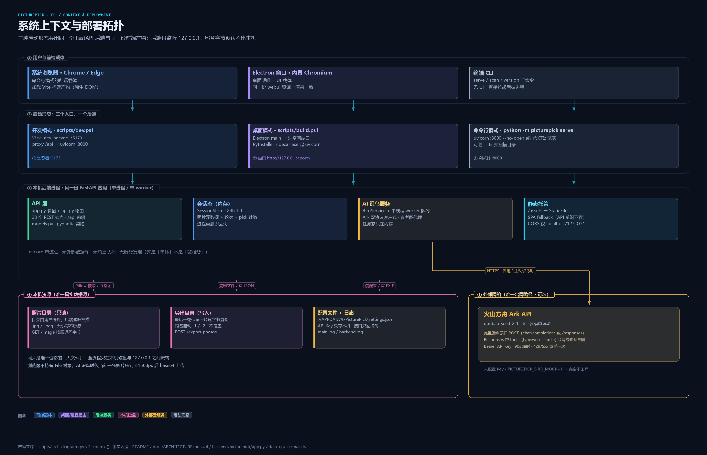
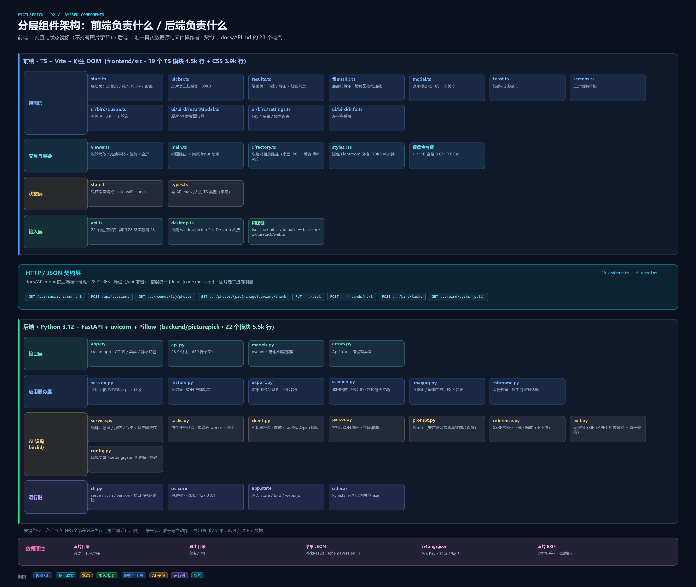
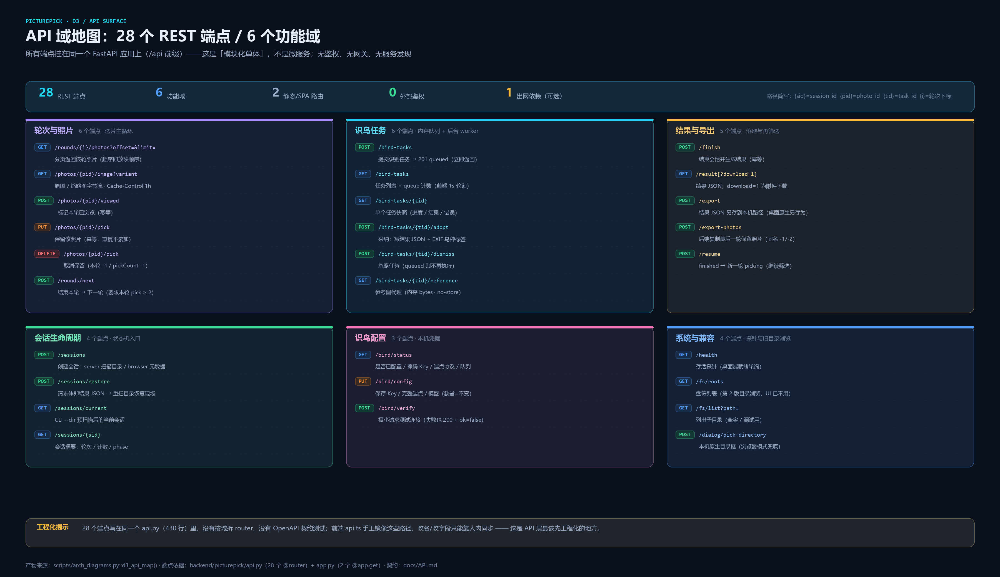
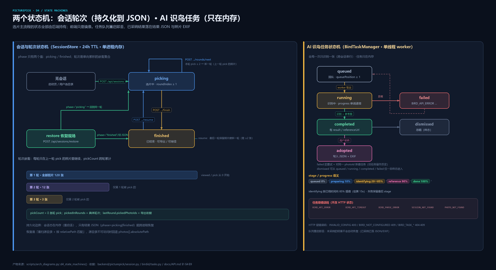
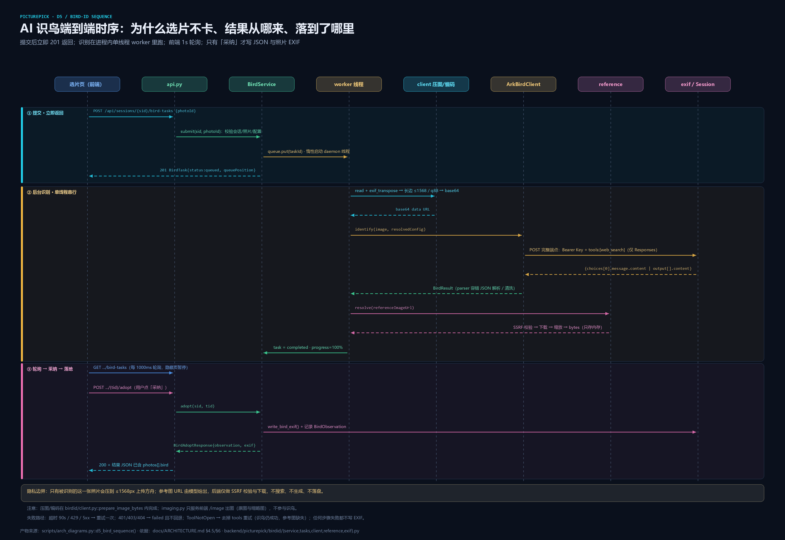

# PicturePick 架构总览（图示版）

> 面向「接手这个项目的人」：一页看懂 **它是什么形态、前后端各负责什么、28 个 API 长什么样、数据怎么流、哪里是工程债**。
>
> - 生成方式：全部图示由 [`scripts/arch_diagrams.py`](../../scripts/arch_diagrams.py) 用 Pillow 直接绘制成 PNG（无浏览器依赖，可复现）。
> - 事实依据：源码 + `docs/API.md`（契约）+ `docs/ARCHITECTURE.md`（约定）；行号均为 2026-11-01 版本。
> - 配套路线图：[`docs/ENGINEERING-ROADMAP.md`](../ENGINEERING-ROADMAP.md)（怎么把它工程化）。

---

## 0. 一句话结论

**PicturePick 是一个「本地优先的模块化单体（modular monolith）」——不是微服务。**

| 维度 | 事实 |
| --- | --- |
| 部署单元 | **1 个** FastAPI/uvicorn 进程（命令行或 Electron 内 sidecar），监听 `127.0.0.1` |
| API | **28 个 REST 端点**，全部挂在同一个应用上（`/api` 前缀），写在**同一个 `api.py`（430 行）**里 |
| 前端 | 1 份静态产物（TS + Vite 原生 DOM，19 个模块 4.5k 行 + 3.9k 行 CSS），由后端托管 |
| 桌面壳 | Electron 主进程（3 个 TS 文件 911 行）+ 内置 Chromium 窗口 + 打包的 Python sidecar |
| 状态 | 会话与 AI 任务**全在进程内存**；唯一持久化是「结果 JSON」与「照片 EXIF」 |
| 出网 | **只有 1 条可选路径**：用户主动点「AI 识鸟」时，把**当前一张**照片压到 ≤1568px 上传火山方舟 |

> 所以「有哪些微服务 API」这个问法本身不成立 —— 正确的问法是「**这台单体内部有哪几个 API 域、边界在哪、将来能不能沿边界拆**」。本文 §3 给出 6 个域和拆分候选。

---

## 1. 系统上下文与部署拓扑



三种入口，共用**同一份后端**与**同一份前端产物**：

| 运行方式 | 前端载体 | 后端进程 | 端口 | 谁提供照片字节 |
| --- | --- | --- | --- | --- |
| 开发模式 `scripts/dev.ps1` | 系统浏览器加载 Vite `:5173` | uvicorn `:8000`（Vite `proxy /api`） | 5173 / 8000 | 后端 `GET /image` |
| 桌面模式 `PicturePick.exe` | Electron 内置 Chromium 窗口 | PyInstaller sidecar `picturepick-backend.exe` | 随机空闲端口 | 后端 `GET /image` |
| 命令行 `python -m picturepick serve` | 系统浏览器 | uvicorn `:8000` | 8000 | 后端 `GET /image` |

**进程边界（桌面模式）**：Electron 主进程选空闲端口 → 拉起 sidecar → 轮询 `/api/health` 就绪 → 窗口加载 `http://127.0.0.1:<port>/`；退出时 `taskkill /T /F` 清理进程树。
证据：`desktop/src/main.ts:280-332`（端口/sidecar）、`412-438`（health 轮询）、`460-508`（清理）。

**唯一出网点**：`BirdService` → `ArkBirdClient` → 火山方舟（HTTP，Bearer Key，90s 超时，429/5xx 重试一次）。未配置 Key 或 `PICTUREPICK_BIRD_MOCK=1` 时完全不访问网络。

---

## 2. 分层架构：前端负责什么 / 后端负责什么



### 2.1 前端实现什么（19 个 TS 模块 ≈4.5k 行 + CSS 3.9k 行）

**核心定位：交互与状态镜像。前端不持有照片字节，不做权威计算。**

| 模块 | 行数 | 职责 | 关键位置 |
| --- | --- | --- | --- |
| `main.ts` | 238 | 入口；**无 URL 路由**，整页替换 `#app.innerHTML` 切三屏 | `main.ts:36-212` |
| `ui/picker.ts` | 985 | **选片主视图**：三栏装配、数据加载、快捷键、自动放映、AI 触发 | `picker.ts:153-278` 等 |
| `ui/results.ts` | 433 | 结果页：下载 JSON / 导出照片 / 继续筛选 / 鸟种胶囊 | `results.ts:65-200` |
| `api.ts` | 336 | **契约唯一封装**：22 个端点函数 + 4 个 URL 构造器；统一错误 toast | `api.ts:142-336` |
| `types.ts` | 309 | 与 `docs/API.md` 对齐的 TS 类型（**手写**，非生成） | — |
| `viewer.ts` | 346 | 缩放 0.05–16×、光标锚点、平移、旋转、适应窗口、1:1、全屏 | `viewer.ts:286-318` |
| `ui/bird/queue.ts` | 331 | 右侧识鸟队列：**1000ms 轮询**、隐藏页暂停、abort、增量更新 | `queue.ts` |
| `ui/bird/resultModal.ts` | 379 | 结果模态框：原照片 vs 参考照片并排对照、采纳/忽略 | — |
| `ui/bird/settings.ts` | 209 | API Key / 完整端点 / 模型设置 + 测试连接 | — |
| `ui/bird/info.ts` | 111 | 左栏「鸟类识别」信息块 | — |
| `ui/filmstrip.ts` | 103 | 底部胶片条（每张一个 button，无虚拟列表） | `filmstrip.ts:52-73` |
| `ui/modal.ts` | 140 | 通用模态框，统一渲染并绑定右上角 X | — |
| `ui/start.ts` | 189 | 启动页：选目录 / 载入 JSON / 设置；隐藏 file input（恢复现场入口） | `start.ts:31-93`、`start.ts:55-62` |
| `desktop.ts` | 132 | 桌面桥接探测：`window.picturePickDesktop` 或 pywebview `?desktop=webview2` | `desktop.ts` |
| `directory.ts` | 73 | 取绝对目录路径：测试注入 → 桌面原生框 → 后端 dialog | `directory.ts` |
| `state.ts` | 109 | **只存设备偏好**（`intervalSeconds`），会话态不在这里 | `state.ts:17-18` |
| `ui/dom.ts` / `ui/screens.ts` / `ui/toast.ts` | 104 / 39 / 60 | DOM 工具 / 三屏骨架 / 单例 toast | — |

**前端明确不做的 4 件事**（这是本项目的架构红线，写在 `docs/API.md` §8.1）：

1. **不读照片文件**：禁止 `webkitdirectory` / File System Access API 导入照片；
2. **不遍历目录**：只把系统对话框返回的**绝对路径**交给后端，扫描在后端完成；
3. **不持有 File 对象 / objectURL**：图片一律 `GET /api/sessions/{sid}/photos/{pid}/image`；
4. **不做权威计数**：pick/viewed 先乐观更新，随后用后端返回的 `SessionSummary` 覆盖（`picker.ts:354-359`、`632-639`）。

### 2.2 后端实现什么（22 个 .py 模块，5503 行）

**核心定位：唯一真实数据源 + 唯一的文件操作者 + 唯一的模型调用者。**

| 层 | 模块 | 行数 | 职责 |
| --- | --- | --- | --- |
| 接口层 | `app.py` | 136 | 装配：CORS（仅 localhost 正则）、`ApiError` 处理器、静态托管 + SPA fallback、`app.state` 注入 |
| 接口层 | `api.py` | 430 | **28 个路由**（单文件，未按域拆 router） |
| 接口层 | `models.py` | 342 | 34 个 pydantic 模型（v1/v2 兼容写法，camelCase 直连契约） |
| 接口层 | `errors.py` | 109 | 26 个错误码 + `STATUS_BY_CODE` + `ApiError` |
| 服务层 | `session.py` | 415 | 会话/轮次状态机、pick 计数、**24h TTL**、finished 结果缓存与失效 |
| 服务层 | `restore.py` | 453 | 从结果 JSON 重建轮次：重扫源目录 + `absolutePath` 回退（≤1000 轮） |
| 服务层 | `scanner.py` | 290 | 递归扫描、照片 ID、**路径越界 `is_within`**、browser 元数据校验 |
| 服务层 | `imaging.py` | 113 | 原图字节 + 缩略图（≤512 / q85，**128 条内存 LRU 缓存**） |
| 服务层 | `export.py` | 285 | 结果 JSON 生成/下载/落盘、照片复制（同名 `-1/-2`，失败回滚） |
| 服务层 | `fsbrowse.py` | 148 | 盘符枚举、目录列举、tkinter 原生目录框（兼容） |
| AI 子包 | `birdid/service.py` | 362 | 编排：配置/提交/采纳/忽略/参考图代理 + 鸟种级参考图缓存（≤16） |
| AI 子包 | `birdid/tasks.py` | 404 | 内存任务仓库 + **单线程 daemon worker**（`picturepick-bird-worker`）+ 进度插值 |
| AI 子包 | `birdid/client.py` | 612 | Ark **双协议**（Chat Completions / Responses API）+ `web_search` + `ToolNotOpen` 降级 + 重试 |
| AI 子包 | `birdid/config.py` | 340 | 环境变量 > `settings.json` 优先级、端点协议识别、Key 掩码、原子保存 |
| AI 子包 | `birdid/exif.py` | 313 | 无损写 EXIF：APP1 原位替换 + 内存校验 + 原子替换 + 恢复 mtime |
| AI 子包 | `birdid/reference.py` | 188 | **SSRF 校验** → 下载 → 缩放 → 只返回内存 bytes（不落盘） |
| AI 子包 | `birdid/parser.py` | 166 | 容错 JSON 解析、字段清洗/截断、confidence 夹取 |
| AI 子包 | `birdid/prompt.py` | 65 | 提示词（要求模型联网检索真实图片直链、找不到必须留空） |
| 运行时 | `cli.py` | 282 | `serve` / `scan` / `version`、端口预检、READY 行（供桌面端解析） |

**后端关键不变量**：

- **照片 ID** = `sha1(绝对路径)[:16]`（`scanner.py:75-77`）；browser 来源用 `sha1(relativePath)`。
- **路径越界防护**：出图前 `is_within(session.root, path)`（`scanner.py:180`、`api.py:225`）。
- **会话 24h TTL**（`session.py:52`、`404-405`），过期即不可用；进程重启全部丢失。
- **EXIF 写入只改元数据**：不重编码、图像数据字节不变、失败不影响采纳（`exif.py:235-262`）。

### 2.3 中间是契约，不是代码依赖

前端只通过 `docs/API.md`（28 条）+ 二进制图片响应与后端耦合；后端不会 import 任何前端代码。
**代价**（见 §3.4）：前端 `types.ts` 是手抄的，接口一改就得人肉同步两处。

---

## 3. API 全景：28 个端点 / 6 个域



路径简写：`{sid}`=session_id、`{pid}`=photo_id、`{tid}`=task_id、`{i}`=轮次下标（从 1 开始）。

### 3.1 六个域

| 域 | 端点数 | 一句话职责 | 状态 |
| --- | --- | --- | --- |
| 系统与兼容 | 4 | 健康探针 + 第 2 版遗留的目录浏览 | 2 条前端已不用 |
| 会话生命周期 | 4 | 创建 / 恢复 / 当前会话 / 摘要 | 核心 |
| 轮次与照片 | 6 | 选片主循环：列表、字节流、viewed、pick、下一轮 | 核心 |
| 结果与导出 | 5 | finish / result / export / export-photos / resume | 核心 |
| 识鸟配置 | 3 | 本机凭据：状态 / 保存 / 测试连接 | 可选功能 |
| 识鸟任务 | 6 | 提交 / 列表 / 单任务 / 采纳 / 忽略 / 参考图代理 | 可选功能 |

### 3.2 逐条清单（含前端实际使用情况）

| # | 方法 | 路径 | 请求体 | 响应 | 主要错误 | 前端用 |
| --- | --- | --- | --- | --- | --- | --- |
| 1 | GET | `/api/health` | — | `{status,name,version}` | — | 桌面端轮询 |
| 2 | GET | `/api/fs/roots` | — | 盘符 + home | — | ✗ 未用 |
| 3 | GET | `/api/fs/list?path=` | — | 子目录（≤500） | `INVALID_PATH` | ✗ 未用 |
| 4 | POST | `/api/dialog/pick-directory` | — | `{path,cancelled}` | 501 `DIALOG_UNAVAILABLE` | ✓ |
| 5 | POST | `/api/sessions` | `source/directory/photos` | 201 `SessionSummary` | `INVALID_PATH` `NO_PHOTOS` `INVALID_PHOTOS` `TOO_MANY_PHOTOS` `INVALID_SOURCE` | ✓ |
| 6 | POST | `/api/sessions/restore` | 整份 `PickResult` | 201 `SessionSummary`（`restored=true`） | `UNSUPPORTED_SCHEMA` `INVALID_RESTORE` `INVALID_PATH` `INVALID_SOURCE` | ✓ |
| 7 | GET | `/api/sessions/current` | — | `{session|null}` | — | ✓ |
| 8 | GET | `/api/sessions/{sid}` | — | `SessionSummary` | `SESSION_NOT_FOUND` | ✗ 已封装未调用 |
| 9 | GET | `/api/sessions/{sid}/rounds/{i}/photos` | `offset/limit` | `PhotoListResponse` | `ROUND_NOT_FOUND` | ✓ |
| 10 | GET | `/api/sessions/{sid}/photos/{pid}/image` | `variant=original\|thumb` | `image/jpeg` | `PHOTO_NOT_FOUND` | ✓ |
| 11 | POST | `/api/sessions/{sid}/photos/{pid}/viewed` | — | `SessionSummary` | `PHOTO_NOT_FOUND`、409 `PHASE_FINISHED` | ✓ |
| 12 | PUT | `/api/sessions/{sid}/photos/{pid}/pick` | — | `SessionSummary` | `PHOTO_NOT_FOUND`、409 `PHASE_FINISHED` | ✓ |
| 13 | DELETE | `/api/sessions/{sid}/photos/{pid}/pick` | — | `SessionSummary` | `PHOTO_NOT_FOUND`、409 `PHASE_FINISHED` | ✓ |
| 14 | POST | `/api/sessions/{sid}/rounds/next` | — | `SessionSummary` | 409 `NOT_ENOUGH_PICKS` `PHASE_FINISHED` | ✓ |
| 15 | POST | `/api/sessions/{sid}/resume` | — | `SessionSummary` | `PHASE_PICKING` `NOT_ENOUGH_PICKS` `INVALID_SOURCE` | ✓ |
| 16 | POST | `/api/sessions/{sid}/finish` | — | `{result,savedPath}` | — | ✓ |
| 17 | GET | `/api/sessions/{sid}/result[?download=1]` | — | `PickResult` / 附件 | — | ✓ |
| 18 | POST | `/api/sessions/{sid}/export` | `{path}` | `{path}` | `WRITE_FAILED` | ✗（桌面端改走 preload 直写盘） |
| 19 | POST | `/api/sessions/{sid}/export-photos` | `{destination}` | `{destination,copied,files}` | `INVALID_PATH` `NO_PICKED_PHOTOS` `WRITE_FAILED` | ✓ |
| 20 | GET | `/api/bird/status` | — | `BirdStatus`（含掩码 Key、端点协议、队列） | — | ✓ |
| 21 | PUT | `/api/bird/config` | `apiKey/endpoint/model/mock` | `BirdStatus` | 400 `INVALID_CONFIG` | ✓ |
| 22 | POST | `/api/bird/verify` | — | `{ok,message,latencyMs,model}`（失败也 200） | — | ✓ |
| 23 | POST | `/api/sessions/{sid}/bird-tasks` | `{photoId}` | 201 `BirdTask(queued)` | `INVALID_CONFIG` `BIRD_NOT_CONFIGURED` `PHASE_FINISHED` `INVALID_SOURCE` | ✓ |
| 24 | GET | `/api/sessions/{sid}/bird-tasks` | — | `{tasks,queue}` | — | ✓（1s 轮询） |
| 25 | GET | `/api/sessions/{sid}/bird-tasks/{tid}` | — | `BirdTask` | `BIRD_TASK_NOT_FOUND` | ✗ 未用 |
| 26 | POST | `/api/sessions/{sid}/bird-tasks/{tid}/adopt` | — | `{task,observation,exif}` | `BIRD_TASK_NOT_COMPLETED` `BIRD_RESULT_UNAVAILABLE` | ✓ |
| 27 | POST | `/api/sessions/{sid}/bird-tasks/{tid}/dismiss` | — | `BirdTask` | `BIRD_TASK_ADOPTED` | ✓ |
| 28 | GET | `/api/sessions/{sid}/bird-tasks/{tid}/reference` | — | `image/*`（`no-store`） | `BIRD_REFERENCE_UNAVAILABLE` | ✓ |

此外还有 **2 条非 API 路由**：`GET /`（前端 index）与 `GET /{full_path}`（SPA fallback，**API 前缀不会被吞**）——`app.py:72`、`app.py:89`。

**跨域共享约定**：错误统一 `{"detail":{"code","message"}}`；CORS 仅允许 `^https?://(localhost|127\.0\.0\.1)(:\d+)?$`（`app.py:28`）；`/image` 带 `Cache-Control: public, max-age=3600`，`/reference` 为 `no-store`。

### 3.3 为什么说它是单体而不是微服务

| 微服务要素 | 本项目实际 |
| --- | --- |
| 多个可独立部署单元 | ✗ 只有 1 个进程 |
| 服务注册/发现、API 网关 | ✗ 前端直连 `127.0.0.1` 的 FastAPI |
| 进程间 RPC（gRPC/消息队列） | ✗ 域之间是**同进程函数调用**（`api.py` → `session.py` / `birdid.service`） |
| 独立数据库 | ✗ 无数据库；状态在内存 + 用户文件系统 |
| 独立扩缩容/故障隔离 | ✗ 不适用（单用户本机工具） |

**这带来 3 个真实的工程后果**（不是缺点，是取舍）：

1. **零网络开销**：扫描、选片、缩略图都是函数调用，没有序列化成本 —— 这是本机工具的正确选择。
2. **边界只存在于代码结构里**：`api.py` 是唯一入口，域之间靠 import 组织；一旦有人在 `api.py` 里直接操作 `Session` 内部字段，边界就烂了。
3. **AI worker 是唯一的「准异步服务」**：它已经在进程内实现了队列 + 单线程 + 状态机（`birdid/tasks.py`），**这是将来若真要把某块拆成独立进程的唯一自然切口**（见路线图 P2）。

### 3.4 契约与实现的 8 处偏差（工程债，已取证）

| # | 偏差 | 证据 |
| --- | --- | --- |
| 1 | 前端给 `/image` 追加了契约未载明的 `_v` / `_r` 查询参数（用于缓存击穿） | `frontend/src/api.ts:326`、`viewer.ts:113` |
| 2 | 前端自造错误码 `NETWORK` / `HTTP_ERROR`，不在 API.md §1 错误码表中 | `api.ts:113`、`api.ts:117` |
| 3 | `origin=browser` 的已结束会话仍会进结果页，但其缩略图必然 404（契约要求这类会话不提供图片） | `main.ts:63-78` vs `docs/API.md:519-520`、`547-548` |
| 4 | API.md 内部自相矛盾：§3 说 dialog 接口「前端不应调用」，§8.1 又把它列为浏览器模式兜底 | `docs/API.md:387-388` vs `751-752` |
| 5 | 5 条端点前端完全不使用（#2 #3 #8 #18 #25） | 见 §3.2「前端用」列 |
| 6 | 桌面端的「结果另存为」绕过 `POST /export`，由 preload 直接写盘（后端接口形同虚设） | `results.ts:347-355` |
| 7 | 422（校验失败）/ 405（方法不允许）返回 FastAPI 默认错误体，不带 `detail.code`；SPA fallback 的 `NOT_FOUND` 也未进错误码表 | `app.py:93`、`app.py:130-132` |
| 8 | 若干实现细节未写进契约：`MAX_PAGE_LIMIT=2000`、restore ≤1000 轮、`PICTUREPICK_DISABLE_DIALOG` 环境变量、restore 会忽略 JSON 里的 `pickCount` | `api.py:61`、`restore.py:55`、`fsbrowse.py` |

> 这些偏差本身不可怕，可怕的是**没有机制能自动发现它们** —— 这正是路线图 P0/P1 里「契约先行」要解决的事。

---

## 4. 数据与状态：两个状态机



### 4.1 会话 / 轮次（持久化到结果 JSON）

- `phase` 只有 `picking` / `finished`；轮次是**嵌套集合**：第 1 轮 = 全部照片，第 i 轮 = 第 i-1 轮被 pick 的照片。
- `pickCount` = 跨轮累计 pick 次数；`pickedInRounds` = 具体轮次；`lastRound.pickedPhotoIds` = 导出依据。
- 关键转移：`POST /rounds/next`（本轮 pick ≥ 2）、`POST /finish`、`POST /resume`（finished → 新一轮 picking，同样要求最后一轮保留 ≥ 2 张）、`POST /restore`（按 JSON 的 `phase` 分流回选片页或结果页）。
- **`phase=finished` 之后的写入会被拒**：pick / unpick / viewed / rounds/next 一律 409 `PHASE_FINISHED`（`session.py:257-264`）；adopt、resume、导出仍然可用。
- **持久化边界**：会话态在内存（24h TTL，重启即丢）；**只有结果 JSON 能跨进程恢复**，恢复方式是「重扫源目录 + 按 `relativePath` 匹配」，源目录不可访问时回退 `photos[].absolutePath`。

### 4.2 结果 JSON（`schemaVersion` 恒为 1）

| 字段 | 含义 | 兼容策略 |
| --- | --- | --- |
| `schemaVersion` | 恒 `1` | 只加可选字段，不升版本 |
| `phase` | `picking`（中途保存）/ `finished` | 缺失按 `finished` 处理（旧 JSON） |
| `photos[]` | **全部**照片，按 `pickCount desc, relativePath asc` | 未 pick 的 `pickCount=0` |
| `lastRound` | 最后一轮仍保留的照片 | 旧 JSON 缺失时按 `pickedInRounds` 推导 |
| `birdIdentifiedCount` / `photos[].bird` | v5 新增，已采纳的鸟种 | 结构不合法时**忽略该字段**，不导致恢复失败 |

### 4.3 AI 识鸟任务（只在内存）

- 状态：`queued → running → completed → adopted`；`completed` 可 `dismissed`；`running → failed`；`failed` 重试 = 对同一 `photoId` **新建**任务。
- 全局**单线程串行**（跨会话），对模型限流友好；`queuePosition` 1-based。
- 进度语义：`queued 0` → `preparing ≥10` → `identifying 20→85`（按已用时间 / 15s 估算插值）→ `reference 90` → `done 100`，**单调不减**（`birdid/tasks.py:362-378`）。
- 任务级错误码（不改 HTTP 状态）：`BIRD_API_ERROR` / `BIRD_API_TIMEOUT` / `BIRD_PARSE_ERROR` / `SESSION_NOT_FOUND` / `PHOTO_NOT_FOUND`。

---

## 5. AI 识鸟链路（唯一出网 + 唯一改文件元数据的链路）



9 步要点（图中共 19 条消息，含返回与竞态细节）：

1. `POST .../bird-tasks {photoId}` → 校验会话/照片/配置 → 入内存队列 → **立即 201 queued**；
2. 单线程 worker：读原图 → `exif_transpose` → 长边压到 ≤1568 / q88 → base64 data URL；
3. `ArkBirdClient` 向**配置的完整端点**原样 POST（`Authorization: Bearer`，`thinking:disabled`）；
   Responses 端点自动带 `tools:[{"type":"web_search"}]` 让模型联网检索参考图；
4. 超时/429/5xx 重试一次；`ToolNotOpen` 去掉 tools 重试（识鸟仍成功，参考图缺失）；
5. `parser` 容错解析 → `BirdResult`；
6. `reference`：对模型给的 `referenceImageUrl` 做 **SSRF 校验** → 下载（≤15MB/6s，只收 `image/*`）→ 缩放到长边 ≤1000 → **只存内存，不落盘**；
7. 任务 `completed`；前端 1s 轮询看到结果；
8. 用户「采纳」→ `POST .../adopt` → `write_bird_exif()`（APP1 原位替换 + 原子替换 + 恢复 mtime）+ 写 `BirdObservation`；
9. 结果 JSON / 后续 restore 均带 `photos[].bird`。

**隐私边界（必须守住）**：只有被识别的那一张照片会上传；参考图 URL 由模型提供，后端只做校验与下载，不搜索、不生成、不落盘。

---

## 6. 质量与验证现状（事实）

| 项目 | 现状 | 证据 |
| --- | --- | --- |
| 后端单元/接口测试 | pytest，**25 个测试文件 / 5136 行**；collect 实测 **292 个用例** | `backend/tests/**` |
| API 端到端 | `scripts/e2e_api.py`，**915 行**（需真实后端 + 样例照片） | `scripts/e2e_api.py` |
| 浏览器 UI 端到端 | `scripts/ui_e2e.cjs`，**700 行**（Playwright + Chromium） | `scripts/ui_e2e.cjs` |
| 前端单元测试 | **不存在**（`frontend/package.json` 无 `test` 脚本、无测试文件） | `frontend/package.json` |
| CI | **不存在**（无 `.github/`） | 仓库根 |
| Lint / 格式化 / 类型检查 | **不存在**（无 ruff/mypy/eslint/prettier；前端仅 `tsc --noEmit`）；但两侧 `tsconfig` 已 `strict: true` | `frontend/tsconfig.json:14`、`desktop/tsconfig.json:9` |
| 覆盖率 | 无 `pytest-cov`、无阈值；代码里已有 29 处 `# pragma: no cover` | — |
| 版本号 | `__version__` 是声明单源，但同一字面量另有 **11 处**散落在 5 个构建/校验脚本、2 个 `package.json` 与 webview 入口；文档标题停在第 5.2 版而内容已到 v5.3 | `scripts/build-electron.ps1`、`desktop/scripts/*.mjs`、`docs/API.md` |
| 依赖可复现性 | `requirements.txt` 全是区间（0 个 `==`）、无 lock；PyInstaller 不在依赖清单；前端 `npm install` 而非 `npm ci` | `backend/requirements.txt` |
| 交付物版本控制 | **12 个修改 + 11 个未跟踪文件尚未提交**（其中 3 项是本次新增的架构文档与图生成脚本） | `git status` |

> 结论：**验证做得很扎实（约 1600 行 e2e 脚本 + 292 个后端用例），但验证只能靠人记得去跑** —— 缺的是「自动拦住错误」的那一层。这正是路线图的起点。

### 6.1 已知高风险（按「该先修」排序，均已取证）

| # | 风险 | 影响 | 证据 |
| --- | --- | --- | --- |
| 1 | **完全无鉴权**，且 `--host` 可绑任意网卡 | 若有人用 `--host 0.0.0.0` 跑，局域网内任何人可列目录、复制照片、改 EXIF、读配置状态 | `app.py:121-128`（只有 CORS）、`cli.py:204` |
| 2 | **会话状态无锁**，而 FastAPI sync handler 跑在线程池 | 并发请求（轮询 + 采纳 + 选片）可能读到半更新状态 | `session.py:267-293`、`Service` worker 同时读会话 `service.py:207-210` |
| 3 | 错误体不统一：只有 `ApiError` 走 `{detail:{code,message}}`，422/405 是 FastAPI 默认体 | 前端错误提示会出现「无 code 的兜底分支」 | `app.py:130-132`、前端 `api.ts:113-117` |
| 4 | 契约与实现细节漂移：`queue` 计数实为按会话、文档称全局；`MAX_PAGE_LIMIT=2000`、restore ≤1000 轮、`PICTUREPICK_DISABLE_DIALOG`、restore 会忽略 JSON 的 `pickCount` 均未写进契约 | 前后端/文档三方不一致，改起来没人敢动 | `birdid/tasks.py:141-153` vs `docs/API.md:334`；`api.py:61`；`restore.py:55`；`fsbrowse.py` |
| 5 | SSRF 只做字面校验：**不解析 DNS**、`urllib` 自动跟随 302 **不复核最终 URL**；模型响应 `read()` 无上限；`export` 结果 JSON 非原子写 | 极端情况下可被重定向绕过；写盘中断会留半截文件 | `birdid/reference.py:52-93`、`birdid/client.py:76`、`export.py:147-151` |
| 6 | Electron `sandbox: false` 且**全仓无 CSP** | 一旦页面被注入（参考图外链、后端返回内容），提权面更大 | `desktop/src/main.ts:530`、`frontend/index.html` |

---

## 7. 如果将来真要拆服务：3 个候选切口

| 候选 | 拆什么 | 前置条件 | 建议 |
| --- | --- | --- | --- |
| A. AI worker 独立进程 | `birdid` 的队列 + worker 抽成独立进程，HTTP/Unix socket 通信 | 任务历史落盘、参考图改对象存储/临时目录 | **最自然**：它已经是异步 + 内存队列，且是唯一出网点（可独立限流/审计） |
| B. 会话状态外置 | `session.py` 状态进 SQLite，API 无状态化 | 引入 DB、事务、迁移脚本 | 有独立收益（**重启可续**），与微服务无关，建议先做 |
| C. imaging 子进程 | 缩略图 CPU 密集，抽子进程池 | 需要 IPC 与缓存策略 | 仅在「上万张大图」场景有意义，**现在不做** |

> 反过来说：**现在拆微服务是负收益** —— 单用户本机工具，进程内调用零成本，拆分会带来部署、调试、版本兼容三重复杂性。路线图把力气放在「内部边界 + 自动化门禁」上。

---

## 8. 怎么重新生成这些图

```powershell
py -3.12 scripts\arch_diagrams.py              # 全部 6 张 → docs/architecture/diagrams/
py -3.12 scripts\arch_diagrams.py --only d3-api --only d4-states
```

- 依赖：仅 Pillow（后端已有依赖）+ Windows 自带字体（微软雅黑 / Consolas），**不需要浏览器、不需要联网**。
- 为什么不用 Mermaid：本机 DSH 沙箱禁止 Chromium/Edge headless 启动（需要命名管道与 crashpad 进程，被沙箱拒绝），无法截图渲染；Pillow 直出 PNG 是确定性的，CI 也能跑。
- 改图 = 改 `scripts/arch_diagrams.py` 里对应的 `d1…d6` 函数，重新运行即可；图内所有事实都应能在源码里找到出处。
